buntu Desktop system hardening report

**Course:** Information Security and Assurance 1  
**Members:** Aaron Angon and Karl Mico A. Velasco  
**Section:** BM12 
**Implementation date for controls 1–15:** 6 October 2026  

## 1 Introduction

We installed Ubuntu Desktop in a virtual machine, examined its initial configuration, and applied selected recommendations from the supplied CIS Ubuntu Linux 26.04 LTS Benchmark v1.0.0 [1]. The project aimed to reduce exposure to unnecessary services and restrict access to sensitive functions while preserving desktop usability.

I completed the VM setup and implemented control categories 1–8. Karl Mico A. Velasco implemented and documented controls 9–15. Related settings are grouped into categories, as required by the project instructions [2]. For example, several file-permission changes count as one category. The report covers selected benchmark recommendations.

## 2 Laboratory environment and method

A Google Cloud host provided remote access to a shared KVM guest. We connected to the host through Chrome Remote Desktop and opened the Ubuntu guest console in Virtual Machine Manager. All controls described in this report were applied inside the guest.

| Item | Observed configuration |
| --- | --- |
| Cloud host | `isa-lab-host` |
| Guest name in Virtual Machine Manager | `isa-ubuntu-desktop` |
| Guest hostname | `isa-pc` |
| Guest account used for verification | `isa-pc1` |
| Operating system | Ubuntu 26.04.1 LTS |
| Virtual hardware model | QEMU Standard PC, Q35 + ICH9 |
| Processor shown in guest settings | Intel Xeon × 2 |
| Memory shown in guest settings | 6.0 GiB |
| Disk capacity shown in guest settings | 42.9 GB |

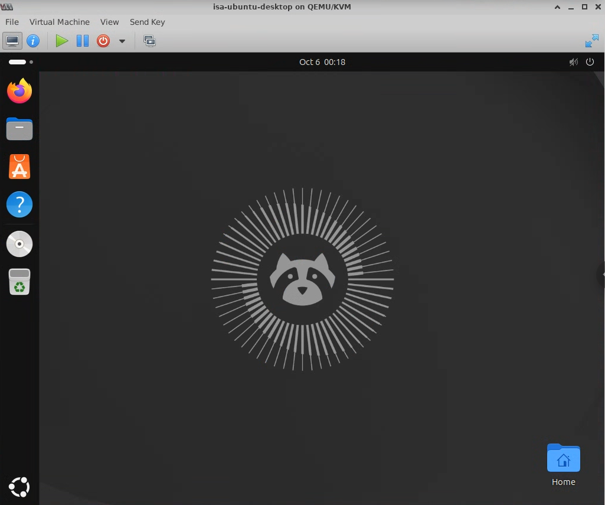

*Figure 1. Ubuntu Desktop running in the KVM guest before the documented hardening work.*

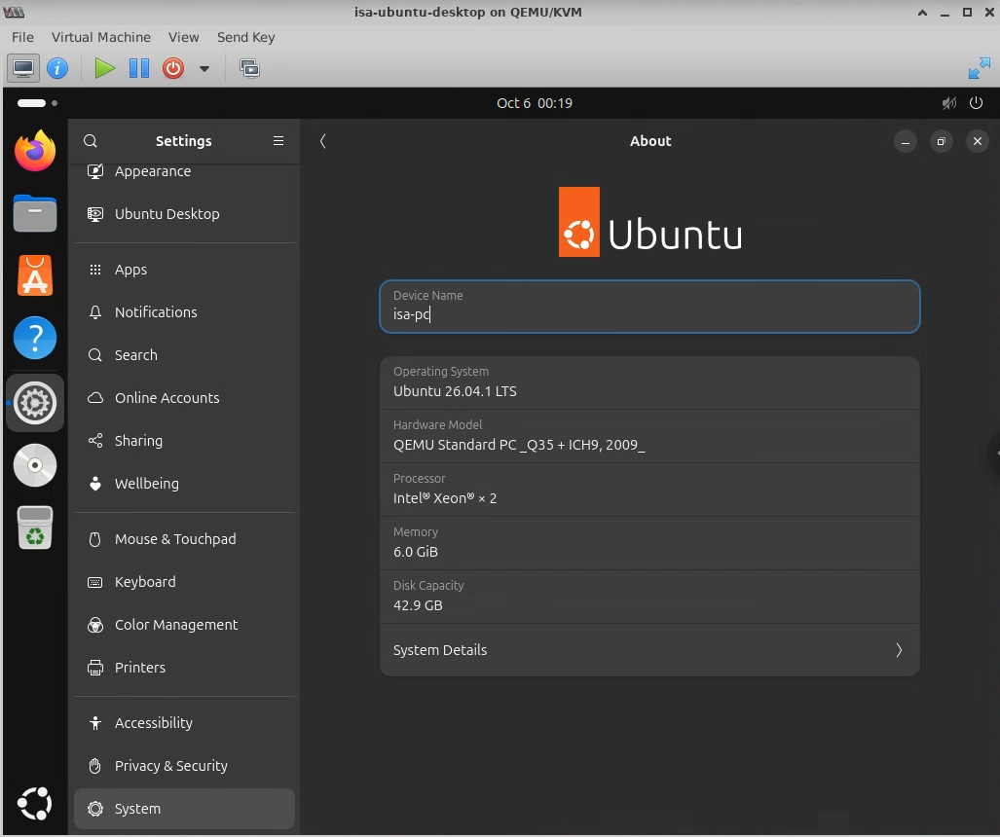

*Figure 2. Guest settings identify Ubuntu 26.04.1 LTS, hostname isa-pc, two virtual processors, 6.0 GiB of memory and 42.9 GB of disk capacity.*

For controls 1–8, I recorded the initial settings, reviewed the relevant CIS recommendations, applied changes with administrative privileges, and verified the resulting configuration. I restarted the guest before checking controls 3–8 to test the settings in a new desktop session. The initial and final terminal outputs were saved in `~/isa-evidence/03-08-before.txt` and `~/isa-evidence/03-08-after.txt`. Configuration backups were stored in `~/isa-evidence/config-backup/`.

The baseline screenshot for controls 3–8 was captured later by opening the saved initial log, `~/isa-evidence/03-08-before.txt`, in `less`. It records the original results; the VM was not restored to its initial configuration for the screenshot. Verification results were collected after the restart. Section 7 records which images were available for inspection during the earlier report update.

For controls 9–15, Karl preserved the first baseline in `~/isa-evidence/09-15-before.txt`, including when the setup had to be retried. Each run saved its installation output, with configuration backups under `/var/backups/isa-09-15-<timestamp>/`. The command `sudo isa-verify-09-15` collected checks after reboot and wrote a harmless event to the audit demonstration file. The report cites the supplied final transcript [4]. Screenshot links use the agreed filenames. At the time of the earlier update, the original images for this set and the complete baseline output had not been supplied for inspection.

Verification was limited to the settings and events shown in the recorded output. A timed screen lock or a new sudo password prompt requires a separate functional test. Reported failures are retained, and expected results are identified separately from observed results.

## 3 Summary of the 15 control categories

| No. | Category | Main change | CIS recommendations [1] | Verification scope and limits |
| --- | --- | --- | --- | --- |
| 1 | Host-based firewall | Enabled UFW with incoming denial and logging | 4.1.2, 4.1.3, 4.1.5 | Active after restart; no external port scan |
| 2 | Unnecessary network services | Removed Avahi and dependent `ipp-usb` | 2.1.2 | Packages absent and UDP 5353 listener absent |
| 3 | Login warning banners | Replaced OS-identifying text with a warning | 1.6.2–3, 1.6.7–8 | Text checked; ownership/mode evidence pending |
| 4 | Screen locking | Enforced 180-second idle policy and immediate locking | 1.7.3 | Values and key lockdown checked; no timed demonstration |
| 5 | Removable media handling | Disabled automatic mounting/opening and locked policy | 1.7.4–5 | Values and key lockdown checked; no insertion test |
| 6 | Scheduled-job access | Created root-only crontab allowlist | 2.4.1.9 | Mode and denied crontab access checked; privileged contents read pending |
| 7 | Default file permissions | Set umask `027` in shell/login/PAM configuration | 5.4.3.3 | Sample directory `750` and file `640`; PAM arguments retained after later work |
| 8 | Process debugging | Tightened `ptrace_scope` from `1` to `2` | 1.5.3 | Runtime value retained after restart; original value already acceptable |
| 9 | Updates and package delivery | HTTPS repositories and daily automatic updates | 1.2.1.11, 1.2.2.1 | Configuration checked; three kernel packages remain upgradable |
| 10 | AppArmor | Added enforced reader profile and kernel restriction | 1.3.1.2, 1.3.1.4; scoped extension | Allowed/denied reads demonstrated; other profiles still unconfined/complaining |
| 11 | Bootloader protection | GRUB authentication for editing, normal boot unrestricted | 1.4.1 | Declarations and password presence checked; boot-menu interaction evidence pending |
| 12 | Network kernel settings | Disabled selected forwarding/redirect/source-route behavior | Selected 3.3.1 and 3.3.2 items | Most selected values retained; two global/default martian-logging failures |
| 13 | Password quality | Length 14, four classes and quality enforcement | 5.3.2.3, 5.3.3.2.1–8 | PAM/policy checked; rejection/acceptance messages not supplied |
| 14 | Privilege escalation | Explicit PTY use and zero sudo authentication timeout | 5.2.2, 5.2.6 | Policy and syntax checked; ordinary-user prompting test output pending |
| 15 | Logging and audit | Persistent journal and selected identity-file audit rules | 6.1.1.1.5–7, 6.2.1.1–2, 6.2.3.12–14 | Loaded rules, real demo event and retained pre-reboot markers checked |

## 4 Implemented controls

### Control 1 Host-based firewall

#### Initial state

`sudo ufw status verbose` reported `Status: inactive`. The socket inventory also showed Avahi listening on UDP port 5353. UFW did not filter guest traffic in this state. The socket inventory identified local listeners but did not establish whether they were reachable from the internet.

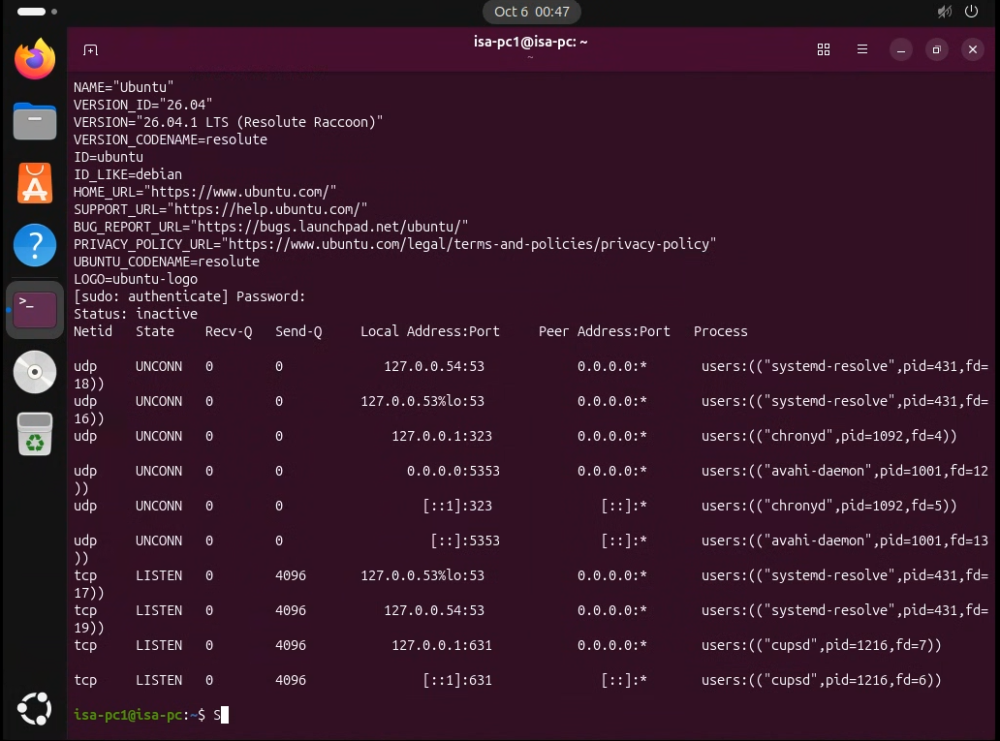

*Figure 3. The initial firewall check reports inactive UFW. The same terminal shows the listening-socket inventory.*

#### Implementation

I enabled UFW with default denial of incoming and routed traffic, allowed outgoing traffic, and enabled low-level logging:

```bash
sudo ufw default deny incoming
sudo ufw default allow outgoing
sudo ufw default deny routed
sudo ufw logging low
sudo ufw enable
```

#### Verification

The recorded output was:

```text
Firewall is active and enabled on system startup
Status: active
Logging: on (low)
Default: deny (incoming), allow (outgoing), disabled (routed)
```

Additional checks returned `enabled` for `systemctl is-enabled ufw.service`, `active` for `systemctl is-active ufw.service`, and `DEFAULT_FORWARD_POLICY="DROP"` in `/etc/default/ufw`.

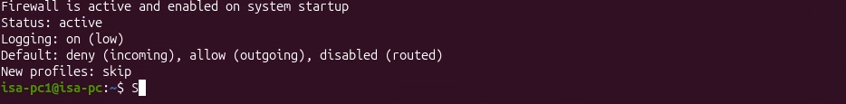

*Figure 4. UFW is active, logging is enabled and incoming traffic is denied by default.*

#### Rationale and limitations

Default incoming denial reduces exposure to unsolicited connections. Services intentionally offered by the guest would need explicit allow rules. Outgoing traffic remains allowed for desktop use and package downloads. The configuration therefore excludes the Level 2 outgoing-denial recommendation, CIS 4.1.4. The benchmark explains that `disabled (routed)` can reflect disabled kernel forwarding; the recorded `DROP` policy provides the separate configuration check [1, §§4.1.2–4.1.5, pp. 547–554]. No external port-scan test was recorded.

### Control 2 Removal of unnecessary network services

#### Initial state

Both `avahi-daemon.service` and `avahi-daemon.socket` were enabled and active. Avahi had UDP listeners on `0.0.0.0:5353` and `[::]:5353`. Its local service-discovery functions were not needed for this lab.

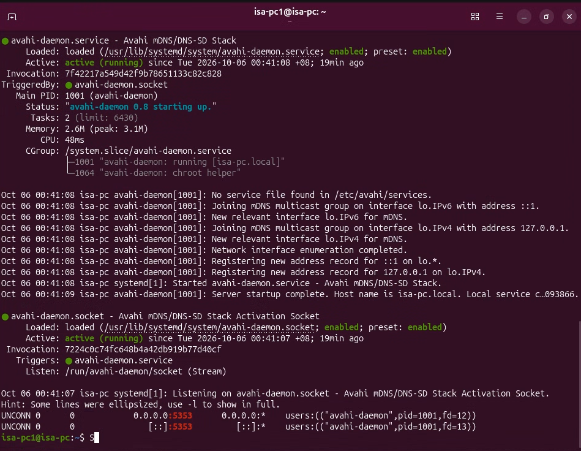

*Figure 5. Avahi's service and activation socket are running, with IPv4 and IPv6 UDP port 5353 listeners.*

#### Implementation

I first simulated removal to inspect the dependencies. The simulation identified only `avahi-daemon` and `ipp-usb` for removal. I then removed both packages:

```bash
sudo apt-get --simulate purge avahi-daemon
sudo systemctl stop avahi-daemon.socket avahi-daemon.service
sudo apt-get purge -y avahi-daemon ipp-usb
```

#### Verification

I checked:

```bash
dpkg-query -s avahi-daemon ipp-usb
sudo ss -ulpn | grep ':5353'
```

Both packages were reported as not installed, and the port check returned no matching listener.

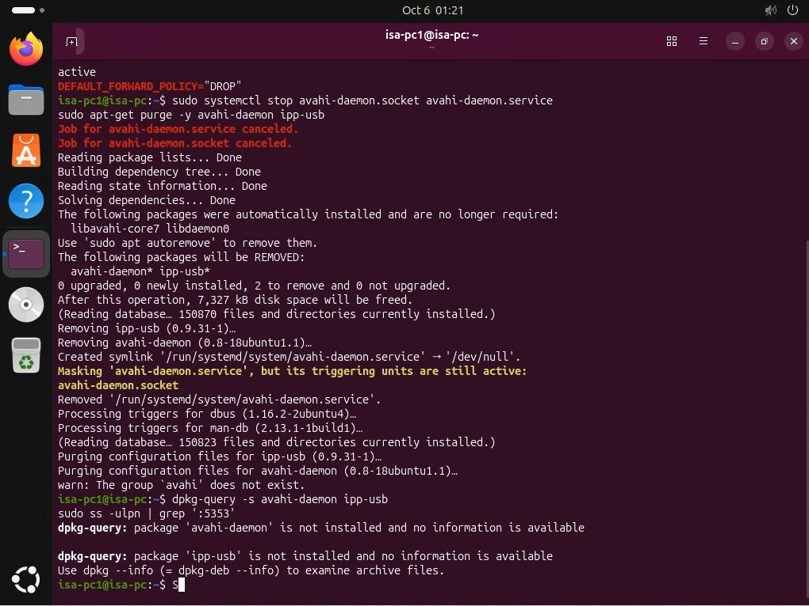

*Figure 6. The package removal completes, the package query confirms both packages are absent, and the final UDP port 5353 check produces no matching output.*

The screenshot also records canceled stop jobs and a temporary socket-activation warning during removal. The final package and socket checks established the resulting state; the initial stop command was not treated as evidence of successful removal.

#### Rationale and limitations

Removing an unused discovery service reduces the guest's attack surface. The removal also eliminates Avahi-based local discovery and `ipp-usb` printing functionality. This implements a recommendation classified as Level 2 for workstations; it was selected because those features were unnecessary in our lab [1, §2.1.2, pp. 283–284]. The removal did not cover other services, including the loopback CUPS listener.

### Control 3 Login warning banners

#### Initial state

`/etc/issue` contained `Ubuntu 26.04.1 LTS \n \l`, and `/etc/issue.net` contained `Ubuntu 26.04.1 LTS`. These identified the operating system and did not provide an authorization warning.

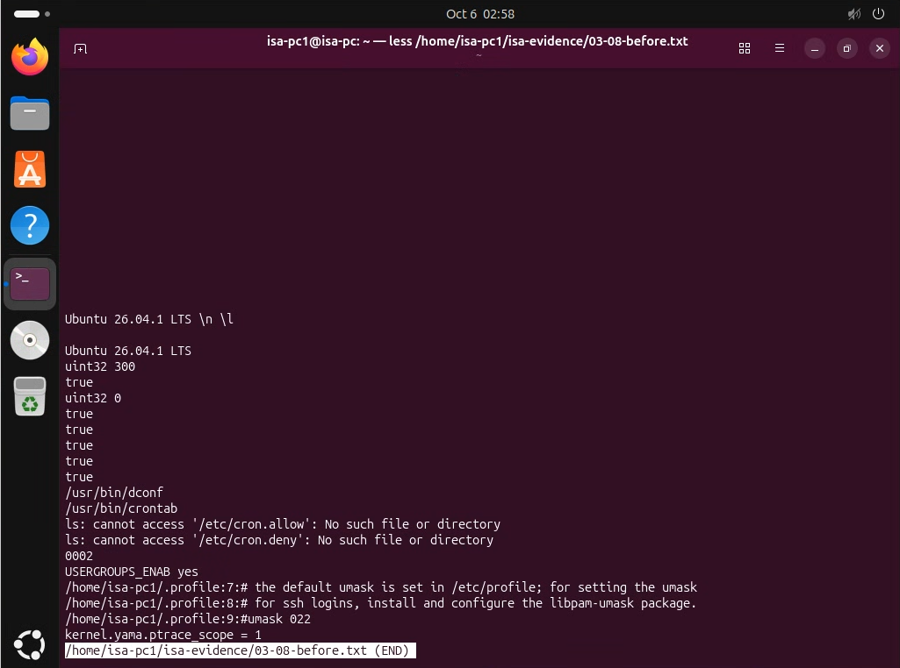

*Figure 7. Shared before evidence for controls 3–8, captured while viewing the saved original log in `less`. The output includes the Ubuntu banner text, GNOME settings and writable checks, missing cron access files, umask `0002`, `USERGROUPS_ENAB yes` and `kernel.yama.ptrace_scope = 1`. The GNOME values are unlabeled in this image; their schema/key mappings are documented in the corresponding control sections.*

#### Implementation

I replaced both files with the same warning and set their ownership and permissions:

```bash
printf '%s\n' \
  'ISA Project Group lab system. Authorized users only. Activity may be logged.' | \
  sudo tee /etc/issue >/dev/null
sudo cp /etc/issue /etc/issue.net
sudo chown root:root /etc/issue /etc/issue.net
sudo chmod 644 /etc/issue /etc/issue.net
```

#### Verification

`cat /etc/issue /etc/issue.net` displayed the warning twice:

```text
ISA Project Group lab system. Authorized users only. Activity may be logged.
ISA Project Group lab system. Authorized users only. Activity may be logged.
```

#### Rationale and limitations

The warning states the access restriction and removes the operating-system version from the banner. Authentication enforcement and actual logging were outside this check. An SSH login banner requires separate configuration beyond editing `/etc/issue.net`; that behavior was not tested [1, §§1.6.2–1.6.3, pp. 226–229; §§1.6.7–1.6.8, pp. 237–240].


*Figure 8. The after output displays the authorization warning twice, once for each banner file. Compare with the original Ubuntu banner text in Figure 7.*

#### Additional evidence required

The image verifies the banner text. Ownership and permissions require a separate check using `stat -c '%a %U:%G %n' /etc/issue /etc/issue.net` to verify the configured `644 root:root` state.

### Control 4 Enforced screen locking

#### Initial state

The GNOME idle delay was `uint32 300`, the lock delay was `uint32 0`, and locking was enabled. The idle and lock-delay settings were writable by the user. The initial values already provided screen locking. This control shortened the idle period and prevented users from relaxing the settings.

#### Implementation

I configured `/etc/dconf/profile/user` with:

```text
user-db:user
system-db:local
```

I created `/etc/dconf/db/local.d/99-isa-screen-lock` with:

```ini
[org/gnome/desktop/session]
idle-delay=uint32 180

[org/gnome/desktop/screensaver]
lock-enabled=true
lock-delay=uint32 0
```

I placed the following key paths in `/etc/dconf/db/local.d/locks/99-isa-screen-lock`, ran `sudo dconf update`, and restarted the guest:

```text
/org/gnome/desktop/session/idle-delay
/org/gnome/desktop/screensaver/lock-enabled
/org/gnome/desktop/screensaver/lock-delay
```

#### Verification

The new session reported:

| GNOME setting | Value | Writable |
| --- | --- | --- |
| `org.gnome.desktop.session idle-delay` | `uint32 180` | `false` |
| `org.gnome.desktop.screensaver lock-delay` | `uint32 0` | `false` |
| `org.gnome.desktop.screensaver lock-enabled` | `true` | `false` |

These were checked using `gsettings get` and `gsettings writable` for the listed schema/key pairs.

#### Rationale and limitations

A three-minute idle policy with no extra locking delay limits unattended-session access. Locking the keys prevents ordinary users from changing that policy through GNOME settings. The shorter idle period can interrupt reading or demonstrations. Configuration and key lockdown were verified, but a timed idle-lock demonstration was not captured [1, §1.7.3, pp. 261–265].


*Figure 9. In the recorded check order, the after output shows idle delay `uint32 180`, lock delay `uint32 0`, locking enabled (`true`) and three writable checks returning `false`. Figure 7 contains the saved initial settings.*

### Control 5 Removable media handling

#### Initial state

GNOME reported `automount=true`, `automount-open=true` and `autorun-never=true`. Automatic mounting and opening were enabled. I retained the existing autorun-prevention setting.

#### Implementation

I created `/etc/dconf/db/local.d/99-isa-media`:

```ini
[org/gnome/desktop/media-handling]
automount=false
automount-open=false
autorun-never=true
```

The following paths were added to `/etc/dconf/db/local.d/locks/99-isa-media`. The system database was rebuilt using `sudo dconf update`, followed by a guest restart.

```text
/org/gnome/desktop/media-handling/automount
/org/gnome/desktop/media-handling/automount-open
/org/gnome/desktop/media-handling/autorun-never
```

#### Verification

Checks under `org.gnome.desktop.media-handling` returned:

| Key | Value | Writable |
| --- | --- | --- |
| `automount` | `false` | `false` |
| `automount-open` | `false` | `false` |
| `autorun-never` | `true` | `false` |

#### Rationale and limitations

The desktop no longer automatically mounts or opens inserted media, and users cannot override the selected GNOME policy. Users may need to mount legitimate media manually. The policy controls GNOME media handling; it does not prohibit all USB devices. No physical-media insertion test was recorded. Automatic-mount restrictions are Level 2 workstation recommendations, while autorun prevention is Level 1 [1, §§1.7.4–1.7.5, pp. 266–272].

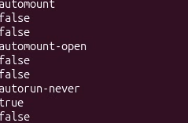

*Figure 10. The labeled checks show `automount=false`, `automount-open=false` and `autorun-never=true`; each key's writable check returns `false`. Figure 7 contains the saved initial settings.*

### Control 6 Scheduled-job access restrictions

#### Initial state

`crontab` was installed, but neither `/etc/cron.allow` nor `/etc/cron.deny` existed. There was no explicit account allowlist. The initial checks did not establish whether every ordinary user could use `crontab`; that behavior depends on the installation's configuration [1, §2.4.1.9].

#### Implementation

I created an explicit allowlist containing only root:

```bash
printf '%s\n' root | sudo tee /etc/cron.allow >/dev/null
sudo chown root:crontab /etc/cron.allow
sudo chmod 640 /etc/cron.allow
```

#### Verification

The checks returned:

```text
640 root:crontab /etc/cron.allow
cat: /etc/cron.allow: Permission denied
You (isa-pc1) are not allowed to use this program (crontab)
See crontab(1) for more information
```

The mode and ownership match the selected benchmark guidance. The ordinary account could neither read the restricted file directly nor access the program through `crontab -l`. The allowlist was configured to contain only root; a final privileged read using `sudo cat /etc/cron.allow` is needed to document its contents.

#### Rationale and limitations

The policy restricts administration of personal cron tables to an approved account. Ordinary users lose the ability to create or modify their own cron jobs through `crontab`. This does not disable the cron daemon or establish that pre-existing scheduled jobs were removed [1, §2.4.1.9, pp. 388–391].

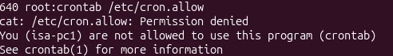

*Figure 11. The after output shows `/etc/cron.allow` with mode `640` and ownership `root:crontab`, a denied direct read and denied `crontab` access for `isa-pc1`. Figure 7 shows that neither cron access file existed initially.*

#### Additional evidence required

Capture `sudo cat /etc/cron.allow` to confirm that the allowlist contains only `root`; the denied ordinary-user read in Figure 11 does not show its contents.

### Control 7 Restrictive default file permissions

#### Initial state

The shell umask was `0002`. No active `UMASK` line was shown in `/etc/login.defs`, and `USERGROUPS_ENAB` was `yes`. With conventional file-creation modes, this mask permits group writing and access by other users; actual before-created sample files were not captured.

#### Implementation

I set `UMASK 027` in `/etc/login.defs`, created `/etc/profile.d/99-isa-umask.sh` containing `umask 027`, and added the same mask to `/etc/bash.bashrc` for interactive Bash sessions. In `/etc/pam.d/common-session`, I configured:

```text
session optional pam_umask.so umask=0027 nousergroups
```

The `nousergroups` option prevents private-user-group handling from relaxing the group bits. Where the PAM module entry already existed, I edited it to avoid duplication. I then restarted the guest and tested creation of a directory and file:

```bash
umask
mkdir -p ~/isa-evidence/permission-check
touch ~/isa-evidence/permission-check/sample.txt
stat -c '%a %n' ~/isa-evidence/permission-check \
    ~/isa-evidence/permission-check/sample.txt
```

#### Verification

The recorded results were:

```text
0027
750 /home/isa-pc1/isa-evidence/permission-check
640 /home/isa-pc1/isa-evidence/permission-check/sample.txt
```

The directory allows its owner full access and its group read/traverse access; the file allows owner read/write and group read. Neither grants access to other users.

#### Rationale and limitations

A restrictive creation default reduces accidental exposure of newly created files. Group collaboration may require explicit permission changes. Existing files retain their permissions, and users can change the default for their own processes. Future PAM regeneration may remove the custom arguments. During control 13, the script restored them, and the final transcript confirms they remain present [4] [1, §5.4.3.3, pp. 756–759].


*Figure 12. The after output shows umask `0027`, mode `750` for the sample directory and mode `640` for its sample file. Figure 7 records the initial umask `0002`.*

### Control 8 Process-debugging restrictions

#### Initial state

`sysctl kernel.yama.ptrace_scope` returned `1`. The original value was within the benchmark's permitted range of `1`, `2` or `3`. I selected `2` as a stricter setting for the lab.


*Figure 13. The shared baseline screenshot records `kernel.yama.ptrace_scope = 1` in the saved original log. This is the same screenshot used in Figure 7.*

#### Implementation

I created and loaded a persistent setting:

```bash
printf '%s\n' 'kernel.yama.ptrace_scope = 2' | \
  sudo tee /etc/sysctl.d/99-isa-process.conf >/dev/null
sudo sysctl -p /etc/sysctl.d/99-isa-process.conf
```

#### Verification

After the guest restart, the check returned:

```text
kernel.yama.ptrace_scope = 2
```

#### Rationale and limitations

Value `2` restricts ptrace use to processes with `CAP_SYS_PTRACE`, reducing ordinary-user debugging access to processes. It can prevent legitimate debugging tools from working without elevated privileges. The persistent runtime setting was verified, but an attempted debugger attachment was not tested [1, §1.5.3, pp. 188–192].


*Figure 14. The after check reports `kernel.yama.ptrace_scope = 2`; the saved initial check in Figure 7 reports `1`.*

### Control 9 Updates and package delivery

#### CIS basis

HTTPS repositories: 1.2.1.11; installation of updates and security software: 1.2.2.1 [1]. The research contribution explains why patching and trusted package delivery belong together [3].

#### Initial state and risk

Before changing this category, Karl saved `/etc/apt/sources.list.d/ubuntu.sources`, the APT periodic-update configuration and the two APT timer states in `~/isa-evidence/09-15-before.txt`. These checks establish the repository transport and update policy at the start of the second implementation session. The preserved baseline is the source for the original values; the final configuration does not establish the initial state. Outdated software can retain known vulnerabilities, while package delivery needs authenticated sources and appropriate transport protection.

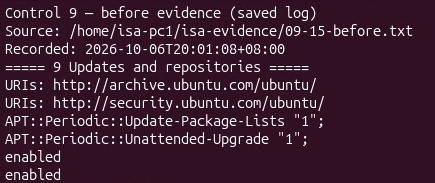

*Figure 15. Saved original repository entries and APT automation settings for control 9. This is a screenshot of the preserved baseline log, not a restored VM.*

#### Implementation

Karl changed the official Ubuntu archive and security repository URIs to HTTPS, refreshed the package indexes, ran the available package upgrade, and installed the security packages needed for the remaining controls. The implementation used the following commands:

```bash
sudo sed -i -E \
  -e 's|https?://([a-z]{2}\.)?archive\.ubuntu\.com|https://archive.ubuntu.com|g' \
  -e 's|http://security\.ubuntu\.com|https://security.ubuntu.com|g' \
  /etc/apt/sources.list.d/ubuntu.sources
sudo apt-get -o APT::Update::Error-Mode=any update
sudo apt-get -o Dpkg::Options::=--force-confold upgrade -y
sudo apt-get -o Dpkg::Options::=--force-confold install -y \
  unattended-upgrades apparmor apparmor-utils libpam-pwquality \
  cracklib-runtime auditd audispd-plugins
sudo systemctl enable --now apt-daily.timer apt-daily-upgrade.timer
```

Karl also configured `/etc/apt/apt.conf.d/20auto-upgrades`:

```text
APT::Periodic::Update-Package-Lists "1";
APT::Periodic::Unattended-Upgrade "1";
```

This enables daily package-list refreshes and unattended upgrades. The recorded allowed origins include the Ubuntu security origin. HTTPS protects package transport alongside APT's repository signature checks. The separate insecure-repository flags proposed in the research PDF were not added as part of our implementation.

#### Verification

The supplied post-reboot verification [4] shows:

```text
URIs: https://archive.ubuntu.com/ubuntu/
URIs: https://security.ubuntu.com/ubuntu/
APT::Periodic::Update-Package-Lists "1";
APT::Periodic::Unattended-Upgrade "1";
```

Both APT timers returned `enabled`. However, `apt list --upgradable` still listed `linux-generic-hwe-26.04`, `linux-headers-generic-hwe-26.04` and `linux-image-generic-hwe-26.04`, with installed version `7.0.0-30.30` and candidate version `7.0.0-38.38`. The repository and automation settings were verified, but these three pending packages show that the system was not fully updated. There is no confirmation that the later suggested upgrade command, which allowed new dependencies, was executed.

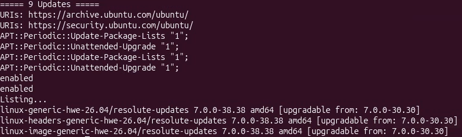

*Figure 16. After evidence for HTTPS repositories, daily update settings and enabled timers. The remaining kernel package upgrades are a documented limitation.*

#### Rationale and limitations

Updates reduce exposure to known software flaws, while automation helps maintain the system after the initial setup. They consume network and disk resources and may require a restart or affect compatibility. The selected settings follow CIS guidance [1, §1.2.1.11, pp. 146–147; §1.2.2.1, pp. 157–158], but the pending packages prevent a claim of a completely current system.

### Control 10 AppArmor application confinement

#### CIS basis

AppArmor enablement: 1.3.1.2; unprivileged unconfined restrictions: 1.3.1.4. The custom enforced profile demonstrates confinement of the lab reader. Compliance of all system profiles with 1.3.1.3 was outside the verification scope [1].

#### Initial state and risk

The baseline collector recorded whether the AppArmor kernel module was enabled, the loaded profile modes, the kernel restriction and any existing `isa-evidence-reader` profile. The final profile totals do not establish the original totals. An application running without an appropriate enforcing profile is not constrained by the custom rules demonstrated here.

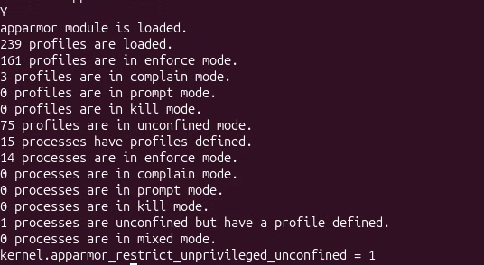

*Figure 17. Saved original AppArmor module, profile-mode and kernel-restriction checks for control 10.*

#### Implementation

Karl installed the AppArmor tools, enabled the service and persisted the following setting in `/etc/sysctl.d/99-isa-apparmor.conf`:

```text
kernel.apparmor_restrict_unprivileged_unconfined = 1
```

Karl created `/etc/apparmor.d/isa-evidence-reader` with an explicit policy for the demonstration reader:

```text
#include <tunables/global>
profile isa-evidence-reader {
  #include <abstractions/base>
  /usr/bin/cat mrix,
  /var/lib/isa-lab/evidence/ r,
  /var/lib/isa-lab/evidence/** r,
  audit deny /etc/isa-private-test r,
}
```

The wrapper `/usr/local/bin/isa-read-evidence` executes `cat` through `aa-exec -p isa-evidence-reader`. Karl loaded the profile and tested a permitted file and a harmless private test file:

```bash
sudo systemctl enable --now apparmor
sudo sysctl -p /etc/sysctl.d/99-isa-apparmor.conf
sudo apparmor_parser -r /etc/apparmor.d/isa-evidence-reader
sudo isa-read-evidence /var/lib/isa-lab/evidence/allowed.txt
sudo isa-read-evidence /etc/isa-private-test
```

The read tests used administrative privileges to distinguish AppArmor denial from restrictions on ordinary-user file access. Karl did not convert every existing profile to enforce mode as proposed in the research PDF. Incomplete profiles require individual testing and adjustment [1, §1.3.1.3].

#### Verification

The post-reboot log [4] reports AppArmor loaded with 240 profiles: 162 enforcing, 3 in complain mode and 75 unconfined. The enforcing list includes `isa-evidence-reader`, and the kernel restriction is `1`. The functional test output was:

```text
Approved ISA evidence: read allowed.
cat: /etc/isa-private-test: Permission denied
PASS: private file denied
```

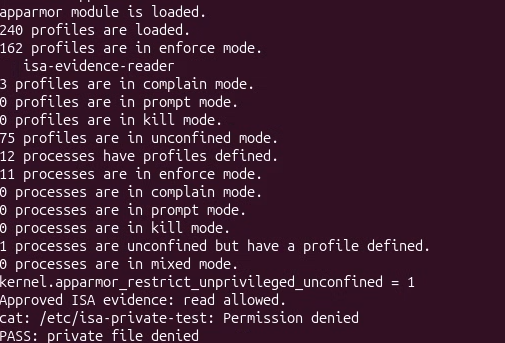

*Figure 18. After evidence for profile modes and the custom reader's allowed/denied access tests. The remaining complain and unconfined profiles limit the scope of the result.*

#### Rationale and limitations

The read tests demonstrate that the enforcing policy restricted the reader's access to specified paths while it ran with elevated privileges. A restrictive policy can also block legitimate application functions unless its rules are maintained. The result applies to the custom reader. Confinement of all desktop applications and satisfaction of the full Level 2 AppArmor recommendation were not established [1, §§1.3.1.2–1.3.1.4, pp. 163–171].

### Control 11 Bootloader protection

#### CIS basis

Bootloader password protection: 1.4.1 [1].

#### Initial state and risk

The baseline recorded GRUB superuser declarations, menu entries and whether a PBKDF2 password entry existed, without printing its hash. Unauthenticated boot editing can allow someone with console access to change kernel parameters and weaken operating-system controls. This risk matters even when the installed system requires a login password.

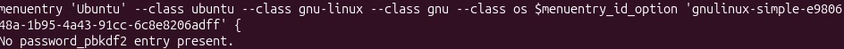

*Figure 19. Saved original GRUB protection checks. Password values and hashes are excluded from the evidence.*

#### Implementation

The setup script created a separate GRUB account named `labadmin`, generated a PBKDF2-SHA512 password hash using 600,000 iterations and a 64-byte salt, and stored the declarations in `/etc/grub.d/01_isa_password`. This file was restricted to mode `700`. The script used these generation and validation commands:

```bash
grub-mkpasswd-pbkdf2 --iteration-count=600000 --salt=64
chmod 700 /etc/grub.d/01_isa_password
update-grub
grub-script-check /boot/grub/grub.cfg
```

These commands ran within the privileged setup script. The report omits the password and hash. The generated configuration includes `set superusers="labadmin"` and `export superusers`.

Karl also added `--unrestricted` to the Linux menu-entry class so the ordinary Ubuntu boot can proceed without the GRUB password, while menu editing and the GRUB command line remain protected. `/etc/default/grub.d/99-isa-boot.cfg` contains:

```text
GRUB_DISABLE_RECOVERY=true
GRUB_TIMEOUT_STYLE=menu
GRUB_TIMEOUT=5
```

#### Verification

The final log [4] shows the `labadmin` superuser declarations, Ubuntu menu entries with `--unrestricted`, and the message `PBKDF2 password configured.` The setup included a GRUB syntax check, and the guest subsequently booted successfully. Authentication after pressing `e` or `c` at the boot menu requires a separate interaction test. No screenshot of that test was supplied with the report materials.

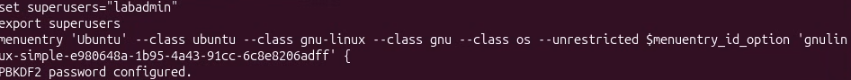

*Figure 20. After evidence for the GRUB superuser, password-entry presence and unrestricted normal Ubuntu boot. The hash is omitted.*

#### Rationale and limitations

Protecting the boot editor reduces opportunities to bypass security through altered boot parameters. Normal boot remains convenient, but recovery options are more restricted and forgetting the separate password complicates maintenance. Changes to GRUB's menu-generation files should be reviewed after package updates. An administrator who controls the cloud host and virtual disks can bypass this protection. Disk encryption was outside this control's scope. The selected behavior follows CIS 1.4.1, which allows unrestricted boot entries while retaining editing protection [1, pp. 173–175]. Verification of all bootloader file permissions under 1.4.2 was outside the scope of this control.

### Control 12 Network kernel settings

#### CIS basis

Selected IPv4 and IPv6 kernel-parameter recommendations under 3.3.1 and 3.3.2 [1]. Multiple network parameters are counted as one category.

#### Initial state and risk

The preserved baseline includes IPv4 forwarding, redirects, source routing, martian logging, SYN cookies and selected IPv6 values. These are compared with the endpoint policy below. The initial numeric values must be read from the preserved baseline. Some protections may already have been enabled by default. A desktop guest does not need to act as a router or accept untrusted route-changing messages for this lab.

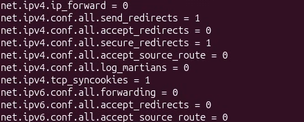

*Figure 21. Saved original runtime checks for the selected network kernel parameters.*

#### Implementation

Karl wrote `/etc/sysctl.d/99-isa-network.conf` with:

```text
net.ipv4.ip_forward = 0
net.ipv4.conf.all.send_redirects = 0
net.ipv4.conf.default.send_redirects = 0
net.ipv4.conf.all.accept_redirects = 0
net.ipv4.conf.default.accept_redirects = 0
net.ipv4.conf.all.secure_redirects = 0
net.ipv4.conf.default.secure_redirects = 0
net.ipv4.conf.all.accept_source_route = 0
net.ipv4.conf.default.accept_source_route = 0
net.ipv4.conf.all.log_martians = 1
net.ipv4.conf.default.log_martians = 1
net.ipv4.tcp_syncookies = 1
net.ipv6.conf.all.forwarding = 0
net.ipv6.conf.default.forwarding = 0
net.ipv6.conf.all.accept_redirects = 0
net.ipv6.conf.default.accept_redirects = 0
net.ipv6.conf.all.accept_source_route = 0
net.ipv6.conf.default.accept_source_route = 0
```

Karl loaded the file with `sudo sysctl -p /etc/sysctl.d/99-isa-network.conf`. The script also wrote explicit persistent values for the existing `enp1s0` and `lo` interfaces: IPv4 redirect and source-route settings `0`, IPv4 martian logging `1`, and IPv6 redirect and source-route settings `0`. The additional reverse-path filtering and IPv6 router-advertisement changes proposed in the research were not applied as part of this category.

#### Verification

The post-reboot checks [4] confirmed IPv4 forwarding `0`, the configured redirect/source-route values `0`, SYN cookies `1`, and the selected IPv6 forwarding/redirect/source-route values `0`. Both existing interfaces also returned the intended values. However, the two global/default martian-logging checks failed:

```text
net.ipv4.conf.all.log_martians = 0
FAIL: net.ipv4.conf.all.log_martians differs from configured value
net.ipv4.conf.default.log_martians = 0
FAIL: net.ipv4.conf.default.log_martians differs from configured value
```

The interface-specific values remained `1`. Troubleshooting identified a possible conflict with UFW's boot-time sysctl settings, but the supplied log did not establish the cause. Application of the proposed correction was also unconfirmed. Two persistence failures therefore remain unresolved, and this category is only partially verified.

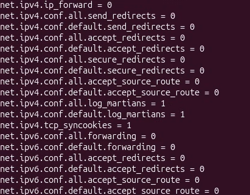

*Figure 22. After-reboot network checks, including the two failed `log_martians` comparisons. The output records both failures.*

#### Rationale and limitations

The policy keeps the guest in an endpoint role, disables the selected redirect and source-route behavior and retains SYN-cookie protection. It would be unsuitable without adjustment if this guest later needed to route traffic or serve as a network gateway. The implemented references are 3.3.1.1, 3.3.1.4–5, 3.3.1.8–11, 3.3.1.14–18 and 3.3.2.1–6; the martian-logging items 3.3.1.16–17 remain unresolved [1, pp. 433–535]. No packet-injection or SYN-flood resistance test was recorded.

### Control 13 Password quality policy

#### CIS basis

Enablement of `pam_pwquality`: 5.3.2.3; selected quality settings: 5.3.3.2.1–8 [1].

#### Initial state and risk

The baseline collector saved existing `pam_pwquality` and `pam_umask` entries and the password-quality configuration files if present. The collector did not explicitly record whether the package was installed. Its absence from the output is therefore insufficient evidence that the package was absent from the system. A weak password chosen during a later password change can undermine account protection even when permissions and firewall settings are restrictive.


*Figure 23. Saved original PAM and password-quality checks. An empty or short section should not be interpreted as a functional password test.*

#### Implementation

After installing `libpam-pwquality` and `cracklib-runtime`, Karl created `/etc/security/pwquality.conf.d/99-isa-quality.conf`:

```text
minlen = 14
minclass = 4
dcredit = 0
ucredit = 0
lcredit = 0
ocredit = 0
difok = 2
maxrepeat = 3
maxsequence = 3
dictcheck = 1
enforcing = 1
enforce_for_root
```

The minimum length is 14, with lowercase, uppercase, digits and other characters required through `minclass=4`. Character credits are disabled, so these classes do not reduce the length requirement. The other settings restrict repetition and sequences, enable dictionary checking and require enforcement for root-initiated password changes. `difok=2` requires differences from the old password when that password is available. The temporary new-account test did not verify this comparison.

The script removed only the managed active options from the main `pwquality.conf` to avoid conflicting overrides, then enabled the PAM profile:

```bash
sudo pam-auth-update --force --enable pwquality
grep 'pam_pwquality' /etc/pam.d/common-password
```

Because PAM regeneration can affect earlier configuration, the script restored `pam_umask.so umask=0027 nousergroups` in `/etc/pam.d/common-session` after this step. It also used a temporary system account with no home directory and a non-login shell for the interactive password-change test, then removed that account. Karl's regular login password was not changed.

#### Verification

The post-reboot evidence [4] confirms the policy values and these active PAM entries:

```text
/etc/pam.d/common-password:password requisite pam_pwquality.so retry=3
/etc/pam.d/common-session:session optional pam_umask.so umask=0027 nousergroups
```

The interactive test stage was completed after an initial failed attempt. However, the final verification log contains only configuration checks; it omits the original password rejection and acceptance messages. A password-test screenshot or installation-log extract is needed to establish weak-password rejection and strong-password acceptance.

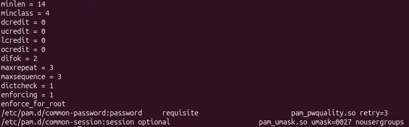

*Figure 24. After evidence for the quality policy, enabled PAM module and retained umask configuration. Functional password-test evidence is separate from these configuration checks.*

#### Rationale and limitations

The policy reduces acceptance of short or predictable passwords through the checked PAM path. More demanding rules can inconvenience users or encourage predictable substitutions, so complexity alone does not guarantee a strong password. The policy applies during future password changes. Existing passwords are unaffected. Account lockout, password history and password aging proposed as extensions in the research were not implemented or counted here [1, §5.3.2.3, pp. 650–652; §§5.3.3.2.1–8, pp. 668–690].

### Control 14 Privilege escalation policy

#### CIS basis

Pseudo-terminal use: 5.2.2; an explicit authentication timeout: 5.2.6 [1].

#### Initial state and risk

The baseline saved the sudo version and explicit `use_pty` or `timestamp_timeout` directives in `/etc/sudoers` and its included directory. Sudo may provide a default behavior without an explicit directive. The saved baseline is needed to establish the initial state, including whether pseudo-terminal use was already enabled. Cached sudo authentication can permit another privileged command without a new password prompt while a user's session is unattended.

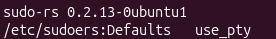

*Figure 25. Saved original sudo version and explicit policy directives.*

#### Implementation

Karl installed `/etc/sudoers.d/99-isa-privileges` with:

```text
Defaults use_pty
Defaults timestamp_timeout=0
```

The candidate policy was checked with `visudo` before installation, then the combined sudoers configuration was validated again. Its ownership was `root:root` and mode `440`. The selected timeout is zero; the research PDF used a 15-minute example. A zero timeout requests authentication for each sudo command that requires a password. Independent `NOPASSWD` exceptions, if present, remain effective.

Relevant validation commands were:

```bash
sudo visudo -c
sudo stat -c '%a %U:%G %n' /etc/sudoers.d/99-isa-privileges
sudo cat /etc/sudoers.d/99-isa-privileges
```

#### Verification

The final verification [4] returned:

```text
Defaults use_pty
Defaults timestamp_timeout=0
440 root:root /etc/sudoers.d/99-isa-privileges
/etc/sudoers: parsed OK
```

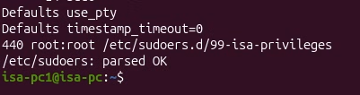

*Figure 26. After evidence for the explicit sudo policy, restricted file access and successful syntax validation.*

The separately requested ordinary-user test was `sudo -k`, `sudo true`, then `sudo -n true`. After successful interactive authentication, the final command is expected to fail because a new password is required. The test output was not supplied, leaving the prompting behavior unconfirmed despite the verified configuration. This control did not include a separate sudo logfile, restrictions on `su`, or removal of password-free exceptions.

#### Rationale and limitations

Explicit pseudo-terminal use and a zero timeout reduce the scope of privileged-session reuse. They also cause repeated password prompts and can disrupt automation that relies on a cached authentication session. Syntax validation reduces the chance of an invalid policy locking out administration, but it does not prove every privilege-escalation path is restricted [1, §5.2.2, pp. 621–623; §5.2.6, pp. 631–632].

### Control 15 Persistent logging and account auditing

#### CIS basis

Journal retention, storage and compression: 6.1.1.1.5–7; auditd installation and startup: 6.2.1.1–2; selected identity-file rules: 6.2.3.12–14 [1]. Logging and auditing are grouped as one category.

#### Initial state and risk

The baseline saved the combined journald configuration, retained boot list, auditd state and any loaded audit rules. The default `Storage=auto` can provide persistent storage when the appropriate journal directory exists, so the baseline does not establish that all logs were previously lost at reboot. This control made local retention explicit and added audit rules for changes to selected identity files.

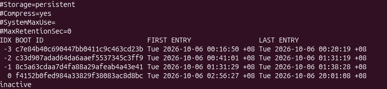

*Figure 27. Saved original journald settings, boot history and audit state for control 15.*

#### Implementation

Karl created `/etc/systemd/journald.conf.d/99-isa.conf`:

```ini
[Journal]
Storage=persistent
Compress=yes
SystemMaxUse=200M
MaxRetentionSec=1month
```

Karl restarted journald, flushed the journal to persistent storage and enabled auditd:

```bash
sudo systemctl restart systemd-journald
sudo journalctl --flush
sudo systemctl enable --now auditd
```

Karl created `/etc/audit/rules.d/99-isa-identity.rules` with eight identity-file rules: each of `/etc/passwd`, `/etc/group`, `/etc/shadow` and `/etc/gshadow` is covered for the `b64` and `b32` syscall architectures, using write/attribute permissions and key `isa_identity`. For example:

```text
-a always,exit -F arch=b64 -F path=/etc/passwd -F perm=wa -k isa_identity
-a always,exit -F arch=b32 -F path=/etc/passwd -F perm=wa -k isa_identity
```

A ninth rule watches the harmless demonstration file:

```text
-a always,exit -F arch=b64 -F path=/etc/isa-audit-test -F perm=wa -k isa_demo
```

Karl loaded the rules with `sudo augenrules --load`. The setup also recorded a journal marker before reboot:

```bash
logger -t isa-project 'ISA controls 9-15: journal persistence test before reboot'
```

#### Verification

Auditd returned `active` and `enabled`, and the post-reboot log lists the eight identity rules and demonstration rule [4]. The verification script appended a harmless event to `/etc/isa-audit-test`. The resulting audit record at 21:01:16 identifies the file, successful `openat` operation, key `isa_demo`, original login identity `auid=isa-pc1` and elevated `uid=root`. The event verifies audit collection for the demonstration file. Real account files were left unchanged during the test.

The journal boot list retained seven boots, including the current boot beginning at 20:58:29. The earlier `isa-project` markers at 20:48:40 and 20:53:53 remained available after that restart. The retained markers verify local journal persistence across reboot. A full month of retention and remote preservation were not tested.

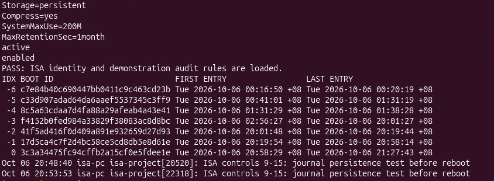

*Figure 28. After evidence for explicit journal storage/retention settings, auditd state and retained boot history. Loaded-rule and event screenshots, when available, provide additional detail.*

Relevant verification commands were:

```bash
sudo auditctl -l
sudo ausearch -k isa_demo -i
sudo journalctl --list-boots --no-pager
sudo journalctl -t isa-project --no-pager -n 5
```

## 5 Group contributions

I, Aaron Angon, completed the cloud-host and Ubuntu guest setup. For controls 1–8, I collected baseline evidence, implemented the configurations, and performed verification. Karl Mico A. Velasco implemented and documented controls 9–15. His research covered their security purposes, CIS recommendations, suggested procedures and tradeoffs [3]. He adapted the proposed procedures to the VM configuration; only the changes recorded in the implementation and verification evidence are reported as completed.

## 6 Results and conclusion

We applied changes across 15 distinct security categories. The resulting guest has an active incoming-denial firewall, reduced service exposure, enforced GNOME policies, an explicit cron allowlist, a restrictive file-creation default, stricter debugging access, automatic-update settings, a scoped AppArmor policy, GRUB protection, network kernel restrictions, password-quality settings, an explicit sudo timeout and persistent logging with selected audit rules.

Some original defaults already provided protection. Screen locking and autorun prevention were enabled, and `ptrace_scope=1` was already within the benchmark's accepted values. These controls strengthened existing protection or enforced settings that users could previously change.

The post-reboot checks verified several controls within the stated scope. The custom AppArmor reader allowed its approved file and denied the private test file. Auditd loaded the selected rules and recorded the demonstration event, while the journal retained pre-reboot markers. UFW remained active and the stricter process-debugging value remained `2`. The password-policy work also retained the earlier PAM umask arguments, although the final collector did not repeat every check from controls 1–8.

However, two areas remained incomplete (due to lack of time): three kernel metapackages were still upgradable, and global/default martian logging returned `0` after reboot despite its configured target of `1`. Other AppArmor profiles also remained unconfined or in complain mode, so the custom profile's successful test cannot be generalized to every application. Functional verification of GRUB authentication, password quality and sudo prompting requires the separate interaction evidence described in those sections.


## 8 References

[1] Center for Internet Security. (2026, August 26). *CIS Ubuntu Linux 26.04 LTS Benchmark* (Version 1.0.0). Supplied course reference PDF. Recommendation numbers and page citations use the document's printed page numbers.

[2] *Information Security and Assurance 1 Final Project*. Supplied project instructions. Requirements used here: Ubuntu Desktop VM, initial-state examination, at least 15 distinct control categories, CIS-based justification, and annotated before/after evidence.


## 9 AI usage

AI assisted with research and command interpretation, virtual-machine setup, verification of results, and preparation of this report. 
